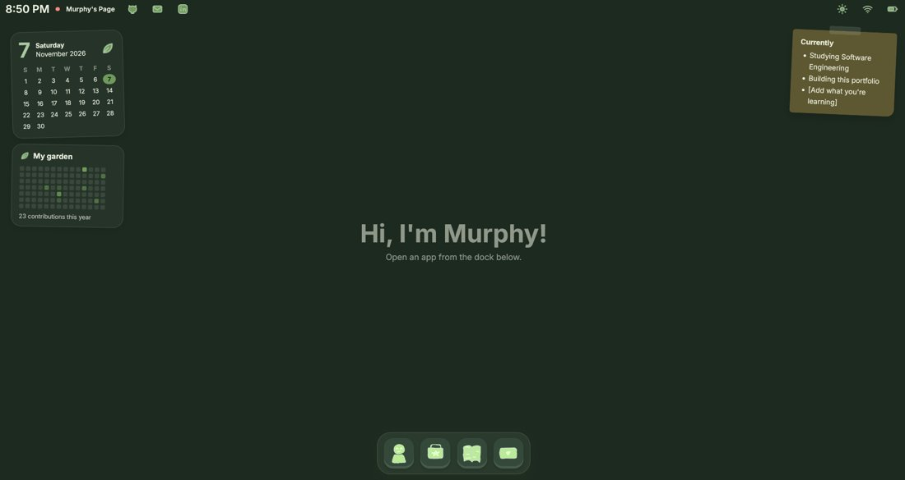
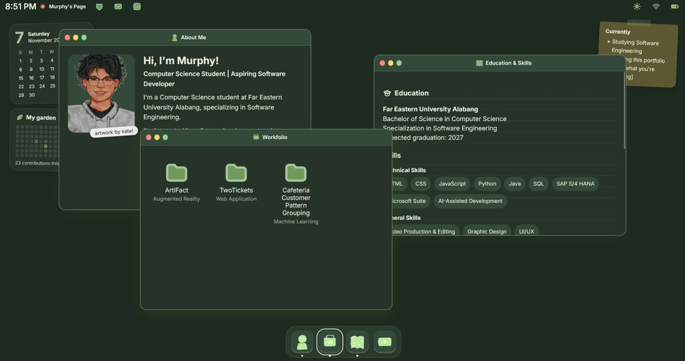

# 🌿 Murphy's Page

### A cozy little desktop you can explore

*Hi, I'm Murphy! Computer Science student, passionate about innovation, AI, and technology.*

**[✨ Step inside: jpillone09.github.io](https://jpillone09.github.io)**

---

## ☕ Welcome in

Pull up a chair! Instead of a regular portfolio page, I built a tiny personal computer you can poke around in. Open a window, shuffle things around, and get to know me and my work at your own pace.

## 🪟 What's on the desktop

| App | What you'll find |
| --- | --- |
| **About Me** | A little intro, who I am, and what I'm aiming for |
| **Workfolio** | My projects, each with screenshots, features, and links |
| **Education & Skills** | Where I study, what I know, and my certifications |
| **Contact Me** | The easiest ways to say hello |
| **Murphy_CV.pdf** | Double-click the file on the desktop to read or download my CV |

## 🍃 Little things to try

- **Drag, resize, minimize or maximize** any window, just like a real desktop
- Press **Ctrl + K** (or **Cmd + K** on Mac) to search for anything: apps, projects, skills, links
- Flip between **light and dark** with the sun/moon in the top bar
- Turn the soft **sound effects** off (or back on) with the speaker icon
- **Right-click** the desktop for a quick menu
- Check **My garden**: my GitHub contributions, drawn as a patch of greens
- Watch the **falling leaves**, and press **Esc** to close the front window

## 🧰 Projects inside

- **ArtiFact**: a gamified augmented reality system that identifies artworks at the National Museum of Fine Arts
- **TwoTickets**: a private, couples-oriented movie diary inspired by Letterboxd
- **This portfolio**: the very desktop you're looking at

Open **Workfolio** on the site to see screenshots and more details for each one.

## 🛠️ Built with

React · TypeScript · Vite · Framer Motion

The icons are hand-drawn, the sounds are generated right in the browser with the Web Audio API, and the site lives on GitHub Pages.

<b>Want to run it on your own computer?</b>

 

1. Install [Node.js](https://nodejs.org) (LTS)
2. Clone this repo and open the folder in a terminal
3. Run `npm install`
4. Run `npm run dev` and open the address it shows (usually http://localhost:5173)

## 💌 Say hello

Have a project in mind? Let's connect!

- 📧 [jpillone09@gmail.com](mailto:jpillone09@gmail.com)
- 💼 [LinkedIn](https://www.linkedin.com/in/jpillone09)
- 🐙 [GitHub](https://github.com/jpillone09)
- 👋 [Facebook](https://www.facebook.com/johnmurphy.pillone.7)

---

*Portrait artwork by [Kate](https://www.linkedin.com/in/katelyn-ong-iko-86173b432/). Thanks for visiting, and stay as long as you like.* 🌱

